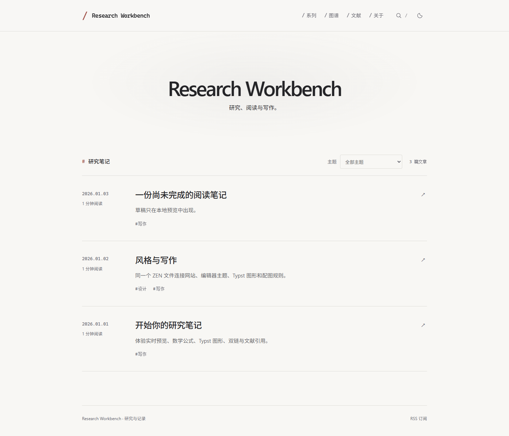

# Research Blog

[中文](README.md) · **English**

A personal research blog and writing setup designed to be operated by coding agents such as Claude Code and Codex—or driven directly from a single Rust CLI (`blogctl`) and VS Code.

Built for technical notes with math, diagrams, and citations: unescaped LaTeX math in Markdown (KaTeX), vector figures compiled from Typst source, bibliography and annotation drafts from local Zotero, wikilinks with a knowledge graph, and static publishing to GitHub Pages. The site templates, VS Code themes, and Typst figure palette all compile from one file: [`ZEN.md`](ZEN.md).

[Starter Live Demo](https://mryu888-plus.github.io/research-blog-demo/) · [Author's Live Site](https://mryu888-plus.github.io/research-blog/) · [Quick Start](#quick-start) · [Agent Guide](AGENTS.md) · [License](LICENSE)


*45-second workflow: `blogctl init`, natural-language `ZEN.md` theme sync across site/IDE/Typst, unescaped LaTeX math, Typst diagrams, and knowledge graph.*



*Default ZEN theme (Graphite & Paper) generated from `ZEN.md`. Colors, typography, layout widths, and figure rules all update together.*

## Built for Coding Agents

Hand a generated site repository to Claude Code or Codex and tell it what you want in plain language—for example:

> "Change the light theme accent color to deep indigo and widen the article column to 760px."

The agent edits one JSON block in [`ZEN.md`](ZEN.md), runs `blogctl zen`, and verifies everything with `blogctl check`. Your website CSS, two VS Code themes, and Typst diagram template stay in sync because:

1. **Single source of truth**: every change category has one canonical file.
2. **One command to verify**: every change category has a deterministic check command.
3. **Clear guardrails**: [`AGENTS.md`](AGENTS.md) (and the generated site's `AGENTS.md`) documents boundaries, private data rules, and verification steps.

| What you ask for | Where it changes | How it is verified |
| --- | --- | --- |
| Colors, fonts, widths, diagram strokes | JSON blocks in [`ZEN.md`](ZEN.md) | `blogctl zen --check` |
| New posts, series, topic hierarchy | Markdown, `site/data/collections.json`, `site/config.toml` | `blogctl check` |
| Vector diagrams | `figures/*.typ` in each post folder | Compiled to SVG on build |
| Citations | `site/data/references.json` | References & backlinks built on compile |
| Layout & templates | `site/templates/` & CSS | `blogctl check` validates links, search index, RSS, and privacy rules |
| Install Zola & Typst | Automatic on first run | `blogctl tools` reports versions and paths |

## Quick Start

Everything runs through a single binary: **`blogctl`**. Download the archive for your OS from [GitHub Releases](https://github.com/mryu888-plus/research-blog/releases) and put it in your `PATH`. No Python or Node.js runtime is required; `blogctl` automatically downloads and checksum-verifies pinned **Zola 0.23.4** and **Typst 0.15.1** on first use.

```sh
blogctl init my-notes --name "My Research Notes" --author "Your Name" --url "https://USERNAME.github.io/REPO/"
cd my-notes
blogctl preview
```

Open the URL printed in the terminal, edit one of the starter posts, and save—the page patches in place without losing your scroll position.

To publish to GitHub Pages: create an empty GitHub repository, enable **Settings → Pages → GitHub Actions**, set `base_url` in `site/config.toml`, and push `main`. The included workflow builds and validates the site automatically.

> Note: the site UI, starter posts, and documentation inside the generated blog are currently in Chinese, while `blogctl` and all CLI workflows work cross-platform on Windows, Linux, and macOS.

## Key Features

- **Unescaped Markdown Math**: Write `$x_i$` and `$$...$$` directly without escaping `_` or `*`; `blogctl` protects math spans in a temporary build copy without modifying your source Markdown.
- **Typst Diagrams as Code**: Store diagram sources in `figures/<id>.typ` next to each post and embed with `{{ <fig id="..." /> }}`. Compiled to crisp SVG on build with click-to-zoom.
- **Wikilinks & Knowledge Graph**: Link notes with `[[Title]]`, `[[Title|Alias]]`, or `[[Title#Heading]]`. Backlinks appear at the bottom of every post alongside an interactive graph page.
- **Series, Topic Tree & Full-Text Search**: Organize long-form sequences in `collections.json`, hierarchical topics in `site/config.toml`, and search client-side across published posts.
- **Live Preview with Drafts**: `blogctl preview` includes `draft = true` posts, watches Markdown, Typst, and `ZEN.md`, and preserves the last valid render if a Typst edit has a temporary syntax error.
- **VS Code Extension & Zotero Workbench** *(optional)*: Connect to local Zotero (`127.0.0.1:23119`), turn PDF annotations into draft notes, autocomplete `[@citekey]` and `[[wikilinks]]`, and manage series order.

## Building from Source

Requires Rust (stable) and Node.js 18+ (only if working on the VS Code extension or frontend JS tests):

```sh
cargo build -p blogctl
cargo test --workspace --locked
```

See [CONTRIBUTING.md](CONTRIBUTING.md) and [docs/architecture.md](docs/architecture.md) for architecture details and contributor checks.

## License

Code, ZEN design tokens, and templates are licensed under the [MIT License](LICENSE). Personal posts, CV files, and third-party assets in this repository are covered separately—see [CONTENT_LICENSE.md](CONTENT_LICENSE.md) and [THIRD_PARTY_NOTICES.md](THIRD_PARTY_NOTICES.md).
