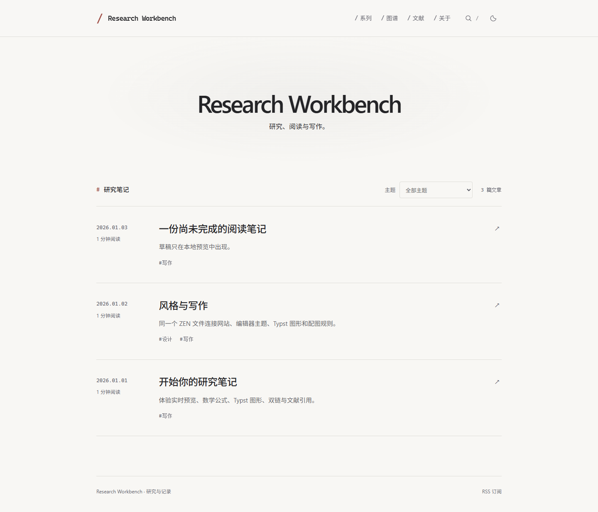
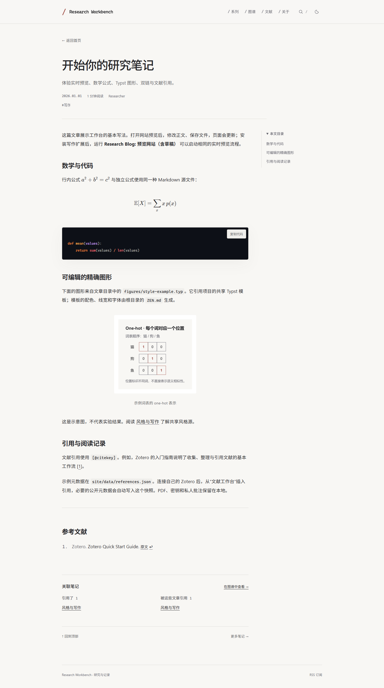

# Research Blog

一套个人博客和写作方案。安装、改样式、加功能都可以交给 Claude Code 或 Codex 这样的 agent 去做，你不用学 Zola、模板语言和 Typst。适合写公式、画图、引文献的人：公式直接写在 Markdown 里，图用 Typst 源码维护，引用从 Zotero 来，发布到 GitHub Pages。这个仓库本身，包括 VS Code 插件、编辑器主题和宣传片，就是这样做出来的。

A personal blog and writing setup that an agent such as Claude Code or Codex can install and customize for you. Built for notes with formulas, figures and citations: math in Markdown, figures from Typst source, references from Zotero, published to GitHub Pages. This repository, including its VS Code extension, editor theme and promo film, was itself built by directing agents. The interface and the documentation are in Chinese.

[作者的网站](https://mryu888-plus.github.io/research-blog/) · [快速开始](#快速开始) · [给 agent 的说明](AGENTS.md) · [使用手册](docs/manual.md) · [自定义风格](docs/style-guide.md) · [参与贡献](CONTRIBUTING.md)



*用模板新建的站点首页，默认 ZEN 配色。颜色、字体和版面宽度都可以改。*

## 让 agent 来做

把仓库交给 agent，用一句话说要什么。比如：

> 把浅色主题的强调色改成蓝色。

agent 会改 `ZEN.md` 里的一个值，运行 `blogctl zen` 和检查。网站样式、两套编辑器主题和 Typst 图形模板都从这一个文件生成，所以网站和图形一起变。它能这样做，是因为仓库给它准备了三样东西：每类修改只有一个地方要改，每类修改有一条命令能验证，`AGENTS.md` 写清了边界和步骤。

| 你说 | agent 改哪里 | 怎么确认没改坏 |
| --- | --- | --- |
| 换颜色、字体、正文宽度、图形线宽 | `ZEN.md` 里的一段 JSON | `blogctl zen --check` |
| 新建文章、系列、主题分类 | Markdown、`site/data/collections.json`、`site/config.toml` | `blogctl check` |
| 画一张图 | 文章目录下的 `figures/*.typ` | 构建时编译 |
| 加一条引用 | `site/data/references.json` | 构建时生成参考文献 |
| 改页面结构 | `site/templates` 和 CSS | `blogctl check` 查链接、索引和不该公开的内容 |
| 建一个新站点 | `blogctl init` | 在新目录里运行 `blogctl check` |
| 装 Zola 和 Typst | 不用装，`blogctl` 第一次用时自己下载 | `blogctl tools` 报告版本和位置 |

文献工作台是例外：它是 VS Code 里的界面，连的是本机的 Zotero，要自己点。插入引用之后的编号、参考文献和文献页仍然由构建生成。

## 快速开始

所有功能都在一个命令行程序 `blogctl` 里。从[发布页](https://github.com/mryu888-plus/research-blog/releases)下载对应系统的压缩包，解压后放进 PATH。不需要 Python 或 Node.js；Zola **0.23.4** 和 Typst **0.15.1** 由 `blogctl` 第一次使用时下载并校验。中文字体要自己装，Windows 和 macOS 自带。

```sh
blogctl init my-notes --name "我的研究手记" --author "你的名字" --url "https://USERNAME.github.io/REPO/"
cd my-notes
blogctl preview
```

打开终端里显示的地址，改一下示例文章再保存，就能看到页面更新。新站点是一份干净的模板，带示例文章、图形、`ZEN.md`、`AGENTS.md` 和 GitHub Pages 发布工作流，不会包含本仓库作者的文章和个人资料。目标目录必须不存在或为空。

也可以交给 agent：装好 `blogctl` 之后，在新站点目录里打开 Claude Code 或 Codex，说要改什么。新站点的 `AGENTS.md` 写了文件在哪、改完怎么验证。

发布前运行 `blogctl check`，构建并检查整个网站。完整流程目前在 Windows 上验证过，CI 在 Linux 上构建，`blogctl` 在 Windows、Linux 和 macOS 上编译发布。

[完整的入门和部署步骤](docs/getting-started.md) · [安装写作插件](extensions/research-blog/README.md)

## 写作

| 功能 | 说明 |
| --- | --- |
| Markdown 与公式 | 用纯文本写推导、代码和长文，公式由 KaTeX 渲染，不用转义 |
| Typst 图形 | 图形用 Typst 源码维护，构建时编译成 SVG，在文章里可以放大看 |
| 双链与图谱 | 用 `[[文章标题]]` 链接笔记，文章底部有反向链接，图谱页显示笔记之间的关系 |
| 系列、主题、全文搜索 | 把相关文章排成系列，按主题筛选，搜索全文 |
| 实时预览 | 预览用的就是网站本身的模板和样式，保存后页面在原位置更新，草稿也能看到 |
| VS Code 插件 | 新建和整理文章，补全链接和引用，跳转章节，检查元数据 |
| 静态发布与 RSS | 推送到 GitHub 就发布到 GitHub Pages，读者可以用 RSS 订阅 |

预览在 VS Code 里运行 **Research Blog: 预览网站（含草稿）**，或在终端执行 `blogctl preview`。改了 Markdown，正文、公式和目录会更新；改了 Typst 文件，图形会重新编译；编译出错时保留上一版页面，改好后自动恢复。正式构建不包含草稿。

<details>
<summary>文章页截图（公式、图形、引用、双链）</summary>



公式写在 Markdown 里，one-hot 示意图由 Typst 源码编译，参考文献根据文中的引用生成。

</details>

## 文献与引用

文献工作台直接读取 Zotero 里的分类、标签、PDF 和批注。读完一篇论文，可以用批注生成一篇阅读笔记草稿，再接着写自己的问题和分析。

- 在工作台里搜索文献、导入 PDF、整理分类和标签。
- 查看摘录和评论，跳回 Zotero 里对应的页面和批注。
- 正文里用 `[@citekey]` 引用文献，有补全、悬停显示书目和 F12 跳转。
- 构建时生成文末的参考文献和全站的文献页，每篇文献被哪些文章引用都能查到。

读 PDF、改批注还是在 Zotero 里做，文献和附件的同步也交给 Zotero。不用 Zotero 的话，书目可以直接写在 `site/data/references.json` 里，格式见 `AGENTS.md`。

## 自定义风格

默认风格叫 ZEN：石墨黑、暖纸白，加一点陶土红。颜色、字体、正文宽度、间距、图形线宽和配图规则都写在 `ZEN.md` 里，网站样式、VS Code 配色和 Typst 图形模板都由这个文件生成。

| 在 `ZEN.md` 里改 | 会影响 |
| --- | --- |
| 颜色、字体、版面尺寸 | 网站的深色和浅色主题、正文排版 |
| 编辑器配色 | 两款 VS Code 主题的基础色、语法色和状态色 |
| 图形参数 | Typst 模板、代码片段和图形补全 |
| 配图规则 | 可选的 AI 配图 |

开着预览时，保存 `ZEN.md` 就能看到网站的变化。更细的布局可以直接改 CSS。编辑器配色要重新打包、安装插件后才会更新；编辑器字体仍然在 VS Code 设置里选。

[自定义风格指南](docs/style-guide.md) · [默认风格文件](ZEN.md) · [编辑器主题](extensions/research-notes-theme/README.md)

## 哪些内容会公开

文章、配置和 `ZEN.md` 都是本地的普通文件。公开网站只包含已发布的文章、这些文章引用的书目信息，以及你自己放进去的内容。PDF、Zotero 数据库、API 密钥和预览设置不会进入网站。

注意：`draft = true` 只决定文章会不会出现在网站上。草稿文件如果提交到公开的 Git 仓库，别人一样能看到。私人笔记请放在仓库外面。

## 可选功能

写作、预览和发布都不依赖这些。

- **插件里的 AI 配图和补全**：根据选中的文字生成配图，补全公式和代码。接口、模型和密钥要自己配置，见[插件说明](extensions/research-blog/README.md)。手里有 agent 的话，这些事也可以直接让 agent 做。
- **文章助手**：一个基于全文索引的问答服务，默认的 `blogctl` 不带它，要从源码用 `--features agent` 编译。只在本机或自己的服务器上运行，GitHub Pages 不跑它。
- **个人简历**：从一份 Typst 源文件生成关于页和简历 PDF。新站点默认关闭，关于页就是普通的 Markdown。

## 参与

项目还在实验阶段，插件即将发布的版本是 **0.3.0**。`blogctl` 和插件分别发布，已发布的旧版本和当前源码有什么区别，见[发布说明](docs/releasing.md)。

从源码改这个项目：装 Rust stable，`cargo build -p blogctl` 编译命令行程序；插件开发另外需要 Node.js。细节见[贡献指南](CONTRIBUTING.md)。

安装、排版、文献功能用起来有问题，请提 Issue；也欢迎直接提 PR，包括新的模板。改代码之前先看 `AGENTS.md`，人和 agent 都适用。

[贡献指南](CONTRIBUTING.md) · [问题反馈](https://github.com/mryu888-plus/research-blog/issues) · [架构说明](docs/architecture.md) · [安全说明](SECURITY.md)

代码、ZEN 设计参数和模板使用 [MIT License](LICENSE)。本仓库作者的个人文章、简历、研究图片和第三方内容不在 MIT 范围内，见[内容许可](CONTENT_LICENSE.md)和[第三方通知](THIRD_PARTY_NOTICES.md)。
