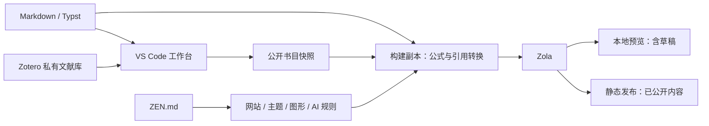

# 工作台架构

Research Blog 把本地写作和静态发布连接起来。Markdown、Typst 和 ZEN 是可以直接编辑、随 Git 管理的源文件；Zotero 保存私有文献，网站只读取选定书目信息。构建、预览和检查都由一个命令行程序 `blogctl` 完成；日常写作与公开阅读不需要运行后端或配置 AI 服务。

## 六条工作流

| 工作流 | 源文件或入口 | 结果 |
| --- | --- | --- |
| 实时写作 | `blogctl preview`、VS Code 的预览命令 | 包含草稿的 Zola 网站，正文、公式、图形及索引随保存更新。 |
| 共享设计 | `ZEN.md` → `blogctl zen` | 网站 CSS 变量、编辑器主题、Typst 模板参数和 AI 规则使用同一份规范。 |
| 文献阅读 | Zotero Local API → VS Code 文献工作台 | 分类与标签检索、PDF 定位、批注草稿、引用与公开书目快照。 |
| 科研表达 | Markdown 公式、文章 `figures/*.typ` | KaTeX 公式与 SVG 图形，保持源文件可编辑。 |
| 知识组织 | 双链、章节、tags、`site/data/collections.json` | 文章回链、图谱、系列、主题归档、搜索与 RSS。 |
| 编辑器辅助 | VS Code 插件与 LSP | 补全、跳转、引用查找、诊断，以及默认关闭的 AI 补全和可选生图。 |

## 实时预览与发布

`blogctl` 同步 ZEN、编译图形，并通过 `PreparedSite` 建立临时构建副本。公式保护和引用排版只修改副本，不改作者 Markdown。预览监听源文件，在 `.tools/site-preview` 生成包含草稿的站点；正式构建输出 `site/public`，排除草稿和预览编辑服务的会话配置。

浏览器的 `site/static/preview.js` 更新页面内容、重新处理公式和关系数据，并保留滚动位置。构建短暂返回 404 或源文件有错误时，页面保留最后一次成功内容并重试。Typst 图形由 watch 进程编译，这些子进程随 `blogctl` 一起退出。系列排序的本地编辑服务是 `blogctl` 里的一个线程，只在预览中启用，监听 loopback，带当前会话凭据；它没有公开网站入口。

当前预览是实际网站的持续构建。已有延迟测试用于观察回归，并不承诺固定的端到端延迟；文章数量、图形复杂度、文件系统和机器性能都会影响更新时间。

## ZEN 的唯一参数源

`ZEN.md` 保存结构化的颜色、字体、尺度、动效和提示词规则。`blogctl zen` 生成 `site/static/zen.css` 和共享 Typst 模板参数；在源码仓库里还生成 `design/zen.generated.cjs`、VS Code 深浅主题、代码片段与补全规则。组件 CSS 保留布局，并引用语义变量。

修改规范后运行 `blogctl zen`，检查使用 `--check`。网站构建也会同步，插件构建会检查是否已同步；实时预览监听 ZEN。已安装的 VSIX 需要重新打包与安装，GitHub Pages 需要正常发布，才能获得更新。复制到文章中的图形由作者维护，同步器不会改写文章内容或已有位图。

## 文献和数据边界

Zotero 是文献条目、附件和批注的来源。插件连接本机 API；修改操作通过 Zotero 的授权窗口获取密钥，保存到 VS Code SecretStorage。原始条目与批注的离线缓存位于扩展私有存储。Windows 上的 `blogctl zotero` 从官方源下载独立客户端到 `.tools/zotero`，并校验签名；仓库和安装包不携带 Zotero 二进制或文献库。

插入 `[@citekey]` 或从批注生成笔记时，插件将书目信息白名单写入 `site/data/references.json`。离线构建也可读取文章旁的 `refs.bib`。公开文献页只展示已发布文章实际引用的条目，并生成文章回链。书目快照不含 PDF、本机附件路径、API 密钥或原始批注；阅读笔记中的摘录和评论是作者主动保存的文章内容，发布前仍应由作者检查。

原生 Zotero 负责 PDF 阅读、编辑批注、附件存储及账号同步。博客文章与公开快照随 Git 管理。两种同步分别配置，`.tools` 和 VS Code 私有缓存不会通过 Git 同步。现有 API 适配已在 Windows/Zotero 10 上验证，具体平台与设置见插件文档。

## 可选组件

- `profile/cv.typ` 是本仓库个人站点的资料源；`[extra] profile_enabled = false` 可关闭自动导出，新生成站点默认关闭并使用普通 About 页面。
- 文章助手：`blog-ir` 解析文章，`blog-build` 建立 Tantivy 索引，`blog-agent` 提供本机 Axum API。它们只在 `blogctl` 用 `--features agent` 编译时加入，命令是 `blogctl agent index` 和 `blogctl agent serve`。
- AI 补全会向所配置服务发送有限光标上下文；生图发送选区及相应规则，使用参考图时也会发送图片。它们按需配置，密钥不进入网站。文章助手读取索引并返回回答，没有写文件或发布权限。
- 静态网站公式默认从 jsDelivr 加载固定版本 KaTeX。网站可不运行服务端，但公式脚本首次加载仍需访问此资源；调整为本地资源时应保留其许可证。

## 代码导航

| 位置 | 职责 |
| --- | --- |
| `crates/blogctl` | 命令行入口：`init`、`new`、`build`、`check`、`validate`、`preview`、`resume`、`zen`、`tools`、`zotero`。 |
| `crates/blog-site/src/init.rs`、`build.rs` | 创建不含个人资料的独立站点；模板、样式和示例在编译时打包进程序。 |
| `crates/blog-site/src/tools.rs` | 下载固定版本的 Zola 和 Typst 到用户缓存，校验哈希和版本。 |
| `crates/blog-site/src/builder.rs`、`preview.rs` | 构建、预览、图形编译。 |
| `crates/blog-site/src/prepare.rs`、`math.rs`、`references.rs` | 临时副本、公式保护、引用与书目输出。 |
| `crates/blog-site/src/zen.rs`、`ZEN.md` | 共享设计与生成规则。 |
| `crates/blog-site/src/check.rs` | 公开网站的链接、锚点、索引和排除规则检查。 |
| `AGENTS.md`、`examples/starter/AGENTS.md` | 给 agent 的文件地图、修改规则和验证命令；新站点带后者。 |
| `extensions/research-blog/src` | 写作命令、语言服务、文献适配和 AI；预览和构建调用 `blogctl`。 |
| `extensions/research-notes-theme` | ZEN 生成的 VS Code 深浅配色。 |
| `site/templates`、`site/static` | 静态阅读界面与浏览器交互。 |
| `crates/blog-ir`、`blog-build`、`blog-agent` | 可选的文章助手。 |

构建与发布入口见 [README](../README.md)，详细检查见 [CONTRIBUTING](../CONTRIBUTING.md)。
